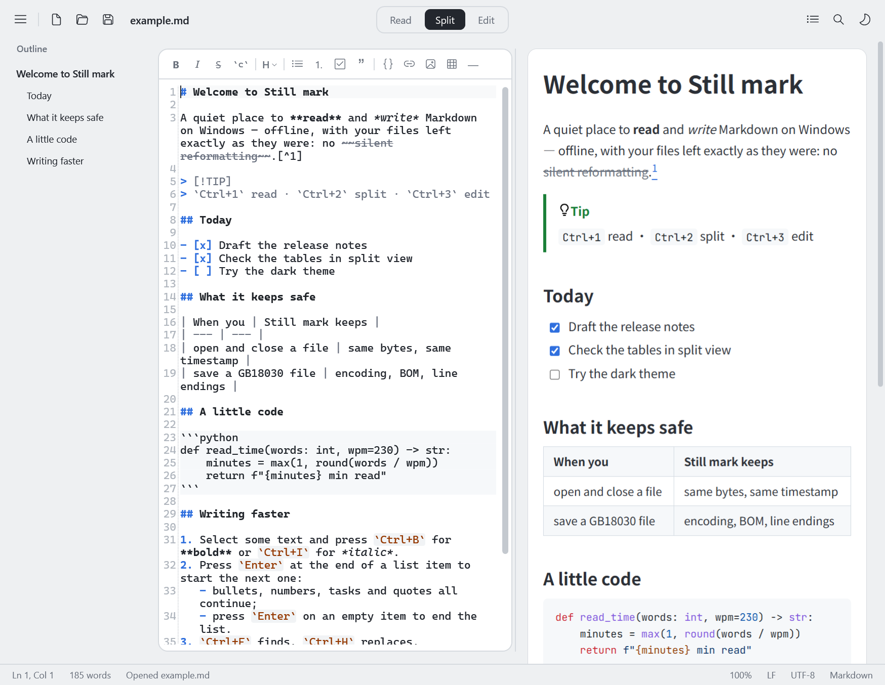

# Still mark

**English** · [简体中文](README.zh-CN.md)

A local Markdown reader and editor for Windows. It runs completely offline — no account, network or paid service needed. The interface is available in English and Simplified Chinese.



## Run it

Download the installer or the portable version from [Releases](https://github.com/wming9728-gif/Still-mark/releases): run `StillMark-<version>-setup.exe` and start Still mark from the Start menu, or unzip `StillMark-<version>-portable.zip` and run `StillMark\StillMark.exe` inside it. Open [docs/example.md](docs/example.md) for a quick tour.

Still mark is not code-signed, so the first time it runs Windows may show "Windows protected your PC"; click "More info", then "Run anyway". `SHA256SUMS.txt` on the same page lets you check that the downloaded files are intact.

You can also build it from source (see [Building](#building)): the portable program ends up in `dist\StillMark\StillMark.exe`, the installer in `dist\installer\StillMark-<version>-setup.exe`.

- Runs on Windows 10 and Windows 11 (64-bit).
- Portable: nothing to install, and no .NET installation needed (the runtime is bundled in the exe).
- Installer: installs for the current user by default, without administrator rights (installing for all users is offered as well); no .NET installation needed either; requires Windows 10 version 1809 or later. Uninstall it from Windows Settings → Apps.
- The preview uses the Microsoft Edge WebView2 Runtime: it ships with Windows 11; on Windows 10 it is usually installed together with Microsoft Edge, and it can also be downloaded free from Microsoft. If it is missing, editing and saving still work and the preview area explains what is needed.
- Opening files: drag a `.md` file onto the window (editor or preview), use Menu → Open…, or run `StillMark.exe <path>`.
- Still mark never writes to the registry and does not register file types, so it is **not** in the "Open with" list at first. Add it once:
  1. In File Explorer, right-click any `.md` file → "Open with" → "Choose another app".
  2. Scroll to the bottom, click "Choose an app on your PC" and select `StillMark.exe`.
  3. "Always" makes Still mark the default for `.md` files (double-click opens them in Still mark); "Just once" only uses it this time.

  After that, Still mark stays in the "Open with" list. If you move the Still mark folder later, select it again the same way.

  That is for the portable version. The installer offers "Add Still mark to 'Open with' for .md / .markdown files" (checked by default); with it, Still mark is in the "Open with" list right away. To make it the default app, still choose "Always" under "Open with", or use Windows Settings → Apps → Default apps (Windows does not let programs change the default app themselves). Uninstalling removes these entries.

  Either way works: the portable version itself never writes to the registry, so adding it to "Open with" is up to you; if you want it set up during installation, use the installer.

## Interface language

- By default Still mark follows the Windows display language: Chinese on Simplified Chinese systems, English everywhere else (Traditional Chinese systems currently get English too).
- Menu → `Language / 语言` switches between "Use System Language", English and 简体中文. The change applies **immediately**, without a restart, and is remembered.
- `--lang en` / `--lang zh-Hans` on the command line picks the language for one session only (the saved choice is unchanged).
- The Open / Save file dialogs are drawn by Windows and always use the system language; the print dialog uses the language Still mark started with.

## Using Still mark

| Area | What it does |
| --- | --- |
| `Read / Split / Edit` (top centre) | Three modes. Split = edit the source on the left with a live preview on the right; both sides scroll together |
| Outline (left) | Click a heading to jump to it. Shown at every start and whenever a file is opened; hide it for the session with the button at the top right or Ctrl+Shift+O. In Split mode it narrows automatically to leave room for both panes, and it steps aside automatically on narrow windows (below about 900 px in Split mode, 700 px otherwise) |
| Toolbar above the editor | Bold, italic, strikethrough, inline code, heading level, lists, task list, quote, code block, link, image, table, horizontal rule |
| Right-click menus | Editor: undo, redo, cut, copy, paste, select all, common formatting, find, replace. Preview: copy, select all, copy image / link |
| Top right | Outline toggle, find, theme (one click switches between light and dark; "Use System Theme" is under ≡ menu → View) |
| Status bar | Caret position, word count, zoom, line endings (LF / CRLF / mixed), encoding (UTF-8 / UTF-8 BOM / UTF-16 / GB18030) |
| ≡ menu (top left) | File commands, recent files, edit, view, language, file format conversion, export to HTML, print, about. View → "Code Ligatures in Preview" is off by default, so code reads exactly as written (`<=` is not drawn as `≤`); turn it on if you like ligatures |

Keyboard shortcuts:

| Shortcut | Action | Shortcut | Action |
| --- | --- | --- | --- |
| Ctrl+N / Ctrl+Shift+N | New / new window | Ctrl+F / Ctrl+H | Find / replace |
| Ctrl+O | Open | F3 / Shift+F3 | Next / previous match |
| Ctrl+S / Ctrl+Shift+S | Save / save as | Ctrl+1 / 2 / 3 | Read / Split / Edit |
| Ctrl+Z / Ctrl+Y | Undo / redo | Ctrl+B / Ctrl+I | Bold / italic |
| Ctrl+K / Ctrl+Shift+K | Link / code block | Ctrl+Alt+1…6 | Heading level |
| Ctrl+` | Inline code | Ctrl+= / Ctrl+- / Ctrl+0 (or Ctrl+wheel) | Zoom in / out / reset |
| Ctrl+Shift+X | Strikethrough | Ctrl+Shift+O | Show / hide the outline |
| Ctrl+P | Print | Esc | Close the find bar |
| Enter | Continues lists, tasks and quotes; Enter on an empty item ends the list | Shift+Enter | Plain line break |

In the find box, Enter / Shift+Enter also move to the next / previous match — handy if another program has taken over F3.

### About file safety

- No change, no write: saving an unedited document does not touch the file (same bytes, same modification time).
- The original format is kept: encoding, BOM and every line's own line ending (LF / CRLF / mixed); new and pasted line breaks follow the line they are on.
- Rendering is display-only: the preview never writes anything back to the source.
- Safe writes: temporary file in the same folder → flush to disk → byte-for-byte check → atomic replace → check again. If any step fails, the original file is left as it was.
- Conflict protection: changes or deletion by other programs are reported; unsaved work is never silently overwritten, and overwriting needs an explicit confirmation.
- Files whose encoding cannot be identified safely (broken UTF-8, binary, UTF-32, …) open read-only and can only be saved under a new name.
- Unsaved work is written to a recovery draft every 8 seconds; after a crash or a failed save, Still mark asks at the next start whether to restore it.

### Data folder

Settings, recent files, recovery drafts and the preview cache are kept in `data\` next to `StillMark.exe` (portable version). If that folder is not writable (for example under Program Files), `%LOCALAPPDATA%\StillMark` is used instead.

The portable version is recognised by the `portable.txt` file next to `StillMark.exe`, so please keep it (without it, and without a `data\` folder, Still mark behaves like the installed version). The installed version has no such file and keeps its data in `%LOCALAPPDATA%\StillMark`, which updates and uninstalls leave untouched; to remove it completely, delete that folder after uninstalling. Menu → "About Still mark" shows which data folder is in use.

## Project layout

```
StillMark/
├─ src/
│  ├─ StillMark.Core/       UI-independent core: encoding detection, safe writes, session / conflict detection, drafts, Markdown rendering
│  │  └─ Resources/         core messages (CoreStrings.resx English / CoreStrings.zh-Hans.resx Chinese)
│  └─ StillMark/            WPF desktop app: main window, editor extensions, themes, dialogs, preview page (web/)
│     └─ Localization/      UI strings (Strings.resx English / Strings.zh-Hans.resx Chinese) and language switching
├─ tools/                   packaging, icon generation, offline front-end asset download
├─ installer/               installer script (Inno Setup) and the Simplified Chinese setup translation
├─ docs/                    example documents and screenshots
├─ LICENSE / THIRD-PARTY-NOTICES.txt
├─ README.md / README.zh-CN.md
└─ StillMark.sln
```

### Interface translations

Only English and Simplified Chinese are available for now.

All interface text lives in resource files; no language is hard-coded in the source:

- `src/StillMark/Localization/Strings.resx` (English, also the fallback) and `Strings.zh-Hans.resx` (Simplified Chinese);
- `src/StillMark.Core/Resources/CoreStrings.resx` and `CoreStrings.zh-Hans.resx` (file-handling messages).

Both languages must have the same entries with the same placeholders (such as `{0}`). Adding a language means adding `Strings.<culture>.resx` and `CoreStrings.<culture>.resx` and registering the language in `Localization/Loc.cs` and the menu.

## Building

1. Requires the .NET 10 SDK.

```bash
dotnet build StillMark.sln
```

2. Portable release build (self-contained single file in `dist\StillMark`; an existing `dist\StillMark\data` folder is kept):

```bash
powershell -ExecutionPolicy Bypass -File tools/publish.ps1
```

**Note:** the official package (the default output of `tools/publish.ps1`) does not contain the test automation channel. The channel is compiled only into Debug builds and into test packages (`tools/publish.ps1 -WithAutomation`, written to `dist\StillMark-test`), and even there it opens only when the program is started with `--automation <pipe name>` (a named pipe restricted to the current user).

3. Installer (written to `dist\installer\StillMark-<version>-setup.exe`). Requires Inno Setup 6 (for example `winget install JRSoftware.InnoSetup`). The installer contains no test automation channel and no `portable.txt` either:

```bash
powershell -ExecutionPolicy Bypass -File tools/build-installer.ps1
```

## Technology and third-party components

| Component | Used for | License |
| --- | --- | --- |
| .NET 10 / WPF | Desktop app framework | MIT |
| AvalonEdit 6.3 | Source editor (IME, undo / redo, find, mixed line endings kept) | MIT |
| Markdig 1.4 | Markdown parsing (CommonMark + GFM tables / task lists / strikethrough / footnotes / alerts) | BSD-2-Clause |
| Microsoft Edge WebView2 | Reading view and preview rendering | Microsoft |
| highlight.js 11.12 | Code highlighting (bundled offline) | BSD-3-Clause |
| JetBrains Mono | Code font in the preview (bundled offline) | OFL-1.1 |
| LXGW WenKai | The 墨 character in the program icon (the font itself is not included) | OFL-1.1 |
| Inno Setup 6 | Builds the installer (the Simplified Chinese setup text is the unofficial translation by Zhenghan Yang (Kira), MIT License) | Inno Setup License |

Typography: a clean sans-serif layout with GitHub-style tables and code blocks, 16 px text at 1.75 line height, light and dark themes. The reading sheet widens with the window — 1040 px in a normal window, up to 1360 px (text column up to 1180 px) — so a full-screen window keeps only a small margin on each side.

## License

Still mark is released under the [MIT License](LICENSE). The licenses of the third-party components it contains are in [THIRD-PARTY-NOTICES.txt](THIRD-PARTY-NOTICES.txt), which is also shipped next to `StillMark.exe`. The files in `src/StillMark/web/vendor/` and `installer/Languages/` come from those projects and keep their own licenses.
