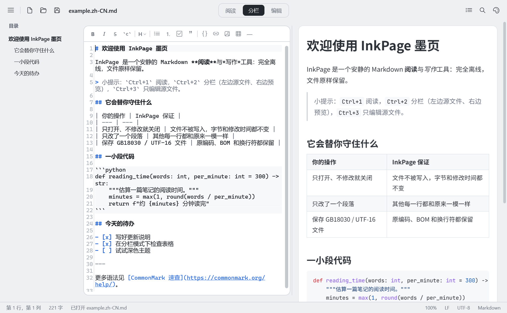

# InkPage 墨页

[English](README.md) · **简体中文**

Windows 11 本地 Markdown 阅读与编辑器。离线运行，无需账户、网络或付费服务。界面支持简体中文与英文。



## 运行

从源码构建便携版（见[从源码构建](#从源码构建)），程序位于 `dist\InkPage\InkPage.exe`。可以打开 [docs/example.zh-CN.md](docs/example.zh-CN.md) 快速体验。

- 便携版，无需安装，也不需要预先安装 .NET（运行时已打包在 exe 内）。
- 预览依赖 Microsoft Edge WebView2 运行时，Windows 11 自带。万一缺失，编辑和保存不受影响，预览区会给出说明。
- 打开文件：把 `.md` 文件拖到窗口上（编辑区或预览区都可以），或用菜单 → 打开，或命令行 `InkPage.exe 文件路径`。
- 程序不会写注册表，也不会自动关联文件类型，所以右键“打开方式”列表里一开始**没有** InkPage，需要手动添加一次：
  1. 在资源管理器中右键任意 `.md` 文件 → “打开方式” → “选择其他应用”；
  2. 拉到列表最下方，点“在电脑上选择应用”，找到 `InkPage.exe`；
  3. 选“始终”会把 InkPage 设为 `.md` 的默认程序（双击即用 InkPage 打开），选“仅一次”则只是这次使用。

  添加过一次后，InkPage 就会一直出现在右键“打开方式”列表里。如果之后移动了 InkPage 所在的文件夹，需要按上面的步骤重新选择一次。

## 界面语言

- 默认跟随 Windows 显示语言：简体中文系统显示中文，其他语言显示英文（繁体中文系统目前也显示英文）。
- 菜单 → `语言 / Language` 可以切换为“跟随系统语言”、English 或简体中文，**立即生效**，无需重启，并会记住选择。
- 命令行参数 `--lang en` / `--lang zh-Hans` 可只为本次启动指定语言（不改变保存的设置）。
- 系统自带的“打开 / 保存”文件对话框由 Windows 绘制，始终使用系统语言；打印对话框使用程序启动时的语言。

## 使用方法

| 区域 | 说明 |
| --- | --- |
| 顶部中间 `阅读 / 分栏 / 编辑` | 三种模式。分栏 = 左侧编辑源文件、右侧实时预览，两侧滚动同步 |
| 左侧“目录” | 点击标题跳转。每次启动和打开文件时都会自动显示；可用右上角按钮或 Ctrl+Shift+O 临时收起；分栏模式下目录会窄一些，给两栏留出空间；窗口很窄时（分栏模式不到约 900 像素宽）会自动让出空间 |
| 编辑区上方工具条 | 粗体、斜体、删除线、行内代码、标题级别、列表、任务清单、引用、代码块、链接、图片、表格、分隔线 |
| 编辑区 / 预览区右键菜单 | 编辑区：撤销、重做、剪切、复制、粘贴、全选、常用格式、查找、替换；预览区：复制、全选、复制图片 / 链接 |
| 右上角 | 目录开关、查找、主题（跟随系统 / 浅色 / 深色） |
| 底部状态栏 | 光标位置、字数、缩放、换行符（LF / CRLF / 混合）、编码（UTF-8 / UTF-8 BOM / UTF-16 / GB18030） |
| 左上角 ≡ 菜单 | 文件操作、最近打开、编辑、视图、语言、文件格式转换、导出 HTML、打印、关于。“视图”里的“预览中的代码连字”默认关闭：代码按原样显示（`<=` 不会画成 `≤`），喜欢连字的可以打开 |

常用快捷键：

| 快捷键 | 功能 | 快捷键 | 功能 |
| --- | --- | --- | --- |
| Ctrl+N / Ctrl+Shift+N | 新建 / 新窗口 | Ctrl+F / Ctrl+H | 查找 / 替换 |
| Ctrl+O | 打开 | F3 / Shift+F3 | 下一个 / 上一个 |
| Ctrl+S / Ctrl+Shift+S | 保存 / 另存为 | Ctrl+1 / 2 / 3 | 阅读 / 分栏 / 编辑 |
| Ctrl+Z / Ctrl+Y | 撤销 / 重做 | Ctrl+B / Ctrl+I | 粗体 / 斜体 |
| Ctrl+K / Ctrl+Shift+K | 链接 / 代码块 | Ctrl+Alt+1…6 | 标题级别 |
| Ctrl+` | 行内代码 | Ctrl+= / Ctrl+- / Ctrl+0 | 放大 / 缩小 / 还原 |
| Enter | 自动续写列表、任务、引用；空项回车结束列表 | Shift+Enter | 普通换行 |

查找框中按 Enter / Shift+Enter 也可以跳到下一个 / 上一个匹配。如果电脑上有其他软件全局占用了 F3，请用这两个键。

### 文件安全（设计重点）

- 不修改就不写入：未编辑的文档执行保存时不会触碰文件（字节和修改时间都不变）。
- 保持原格式：原编码、BOM、每一行原有的换行符（LF / CRLF / 混合）都会原样保留；新输入和粘贴的换行沿用所在行的换行符。
- 渲染只用于显示：预览不会把任何转换结果写回源文件。
- 安全写入：先写入同目录临时文件 → 刷盘 → 逐字节校验 → 原子替换原文件 → 再次校验；任何一步失败，原文件保持不变。
- 冲突保护：文件被其他程序修改或删除时会提示；有未保存修改时绝不静默覆盖，保存前要求明确确认。
- 无法安全识别编码的文件（损坏的 UTF-8、二进制、UTF-32 等）以只读方式打开，只能“另存为”新文件。
- 未保存内容每 8 秒写入一次恢复草稿；程序异常退出或保存失败后，下次启动会提示恢复。

### 数据目录

设置、最近文件、恢复草稿和预览组件缓存保存在 `InkPage.exe` 同目录的 `data\` 中（便携）。若该目录不可写（例如放在 Program Files），自动改用 `%LOCALAPPDATA%\InkPage`。

## 项目结构

```
InkPage/
├─ src/
│  ├─ InkPage.Core/         与界面无关的核心：编码识别、安全写入、会话/冲突检测、恢复草稿、Markdown 渲染
│  │  └─ Resources/         核心库提示文字（CoreStrings.resx 英文 / CoreStrings.zh-Hans.resx 中文）
│  └─ InkPage/              WPF 桌面程序：主窗口、编辑器扩展、主题、对话框、预览页面（web/）
│     └─ Localization/      界面文字（Strings.resx 英文 / Strings.zh-Hans.resx 中文）与语言切换
├─ tools/                   打包、图标生成、离线前端资源下载脚本
├─ docs/                    示例文档与截图
├─ README.md / README.zh-CN.md
└─ InkPage.sln
```

### 翻译

界面文字全部放在资源文件里，代码中不写死任何一种语言：

- `src/InkPage/Localization/Strings.resx`（英文，同时是缺省语言）与 `Strings.zh-Hans.resx`（简体中文）；
- `src/InkPage.Core/Resources/CoreStrings.resx` 与 `CoreStrings.zh-Hans.resx`（文件读写相关的提示）。

两种语言的条目必须一一对应、占位符（如 `{0}`）一致。新增一种语言需要添加对应的 `Strings.<语言代码>.resx` 和 `CoreStrings.<语言代码>.resx`，并在 `Localization/Loc.cs` 与菜单中登记。

## 从源码构建

需要 .NET 10 SDK。

```bash
dotnet build InkPage.sln
```

打包便携版（自包含单文件，输出到 `dist\InkPage`；已有的 `dist\InkPage\data` 会保留）：

```bash
powershell -ExecutionPolicy Bypass -File tools/publish.ps1
```

InkPage 内置一个供界面测试使用的自动化通道，只有用 `--automation <管道名>` 参数启动时才会开启（仅限当前用户访问的命名管道），正常启动时不存在。

## 技术栈与第三方组件

| 组件 | 用途 | 许可 |
| --- | --- | --- |
| .NET 10 / WPF | 桌面程序框架 | MIT |
| AvalonEdit 6.3 | 源码编辑器（输入法、撤销重做、查找、保留混合换行） | MIT |
| Markdig 1.4 | Markdown 解析（CommonMark + GFM 表格 / 任务清单 / 删除线 / 脚注 / 提示块） | BSD-2-Clause |
| Microsoft Edge WebView2 | 阅读与预览渲染 | Microsoft |
| highlight.js 11.12 | 代码高亮（离线打包） | BSD-3-Clause |
| JetBrains Mono | 预览代码字体（离线打包） | OFL-1.1 |

排版：简洁的无衬线布局，GitHub 风格的表格与代码块，正文 16px、行高 1.75，浅色 / 深色两套配色。阅读纸张宽度随窗口变化：普通窗口下为 1040px，窗口越大越宽，最宽 1360px（正文最宽 1180px），全屏时两边不会留出大片空白。
